# Set Up Your Workshop Environment


## Introduction

This workshop guides you through setting up an Autonomous AI Database Serverless environment and installing and configuring the Select AI Agent Framework for Python on an OCI Compute instance.

By combining Autonomous AI Database Serverlessand the Select AI Agent Framework using Python, this workshop demonstrates how developers can build intelligent, AI-powered solutions that use natural-language requests, coordinate specialized agents, invoke database tools, and deliver context-aware responses.

Estimated Time: 30 minutes

### Objectives

In this lab, you will:

- Provision your Autonomous AI Database instance

- Generate SSH keys and provision an OCI Compute instance

- Install and configure Oracle Select AI for Python

## Task 1: Create the Autonomous AI Database Instance

On the Autonomous AI Databases page, select your desired region and compartment. Click Create Autonomous AI Database to start the instance creation process. The Create Autonomous AI Database Serverless page is displayed.

Specify the following:

In the Workload type section, choose a workload type. Select the workload type for your database from the following choices:

- Lakehouse: Built for analytics and AI. Fast insights from a single lakehouse for all your data.

- Transaction Processing: Provides all the performance of the market-leading Oracle Database in an environment that is tuned and optimized to meet the demands of a variety of applications, including: mission-critical transaction processing, mixed transactions and analytics, IoT, and JSON document store.

- JSON: It is Oracle Autonomous Transaction Processing but designed for developing NoSQL-style applications that use JavaScript Object Notation (JSON) documents. You can store up to 20 GB of data other than JSON document collections. There is no storage limit for JSON collections.

- APEX: It is a low cost, Oracle Cloud service offering convenient access to the Oracle APEX platform for rapidly building and deploying low-code applications

For this workshop, choose Lakehouse as the workload type.

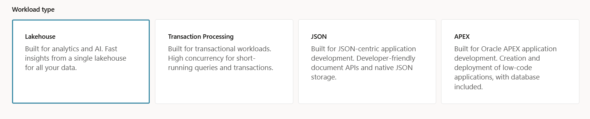

In the Database configuration section, specify the following:

- Always Free: An Always Free databases are especially useful for development and trying new features. You can deploy an Always Free instance in an Always Free account or paid account. However, it must be deployed in the home region of your tenancy. The only option you specify in an Always Free database is the database version. For this lab, we recommend you leave the Always Free slider disabled unless you are in an Always Free account.

- Developer: Developer databases provide a great low cost option for developing apps with Autonomous AI Database. You have similar features to Always Free - but are not limited in terms of region deployments or the number of databases in your tenancy. You can upgrade your Developer Database to a full paid version later and benefit from greater control over resources, backups and more. For this lab, leave the Developer slider disabled.

- Choose database version: Select 26ai for the database version from this drop-down list.

- ECPU count: Choose the number of ECPUs for your service. For this lab, specify 2 ECPUs. If you choose an Always Free database, you do not need to specify this option.

- Compute auto scaling: Accept the default which is enabled. This enables the system to automatically use up to three times more compute and IO resources to meet workload demand.

- Storage (TB): Select your storage capacity in terabytes. For this lab, specify 1 TB of storage. Or, if you choose an Always Free database, it comes with 20 GB of storage.

- Storage auto scaling: For this lab, there is no need to enable storage auto scaling, which would allow the system to expand up to three times the reserved storage. Accept the default which is disabled.

Note: You cannot scale up/down an Always Free Autonomous AI Database.

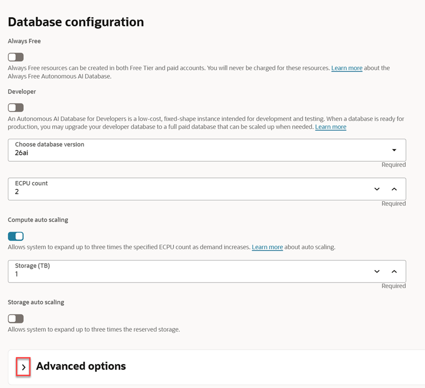

Note: You can drill down on the Advanced options option to take advantage of database consolidation savings with elastic pools or to use your organization's on-premises licenses with bring your own license.

In the Backup section, specify the following:

- Automatic backup retention period in days: You can either accept the default value or specify your own preferred backup retention days value. For this lab, accept the default 60 days default value.

- Immutable backup retention: Accept the disabled default selection.

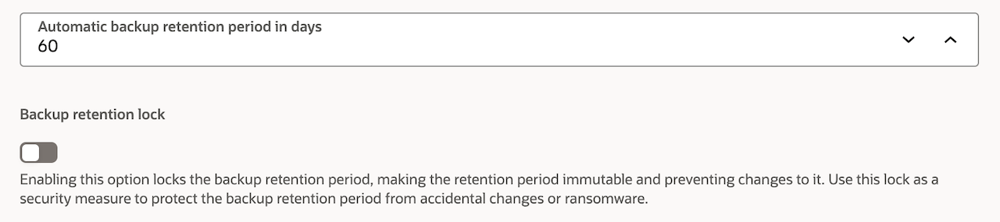

In the Administrator credentials creation section, specify the following:

- Username: This read-only field displays the default administrator username, ADMIN. Important: Make a note of this username as you will need it to perform later tasks.

- Password: Enter a password for the ADMIN user of the service instance choice such as Training4ADW. Important: Make a note of this password as you will need it to perform later tasks.

- Confirm password: Confirm your password.

Note: The password must meet the following requirements:- Must be between 12 and 30 characters long and must include at least one uppercase letter, one lowercase letter, and one numeric character.- Cannot contain the username.- Cannot contain the double quote (") or the single quote (') character.- Must be different from the last 4 passwords used.- Must not be the same password that you set less than 24 hours ago.

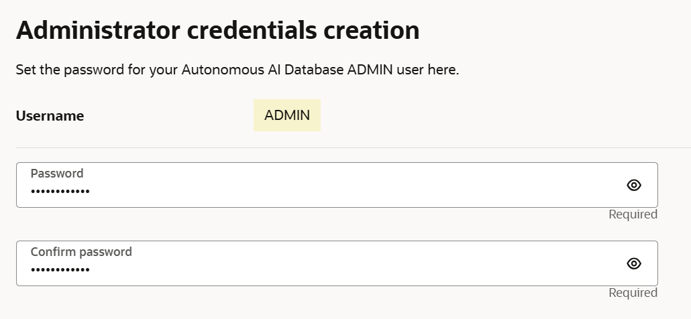

In the Network access section, select one of the following options:

- For this lab, accept the default selection, Secure access from everywhere.

- If you want to allow traffic only from the IP addresses and VCNs you specify - where access to the database from all public IPs or VCNs is blocked, select Secure access from allowed IPs and VCNs only in the Choose network access area.

- If you want to restrict access to a private endpoint within an OCI VCN, select Private endpoint access only in the Choose network access area.

- If the Require mutual TLS (mTLS) authentication option is selected, mTLS will be required to authenticate connections to your Autonomous AI Database. TLS connections allow you to connect to your Autonomous AI Database without a wallet, if you use a JDBC thin driver with JDK8 or above. See the documentation for network options for options to allow TLS, or to require only mutual TLS (mTLS) authentication.

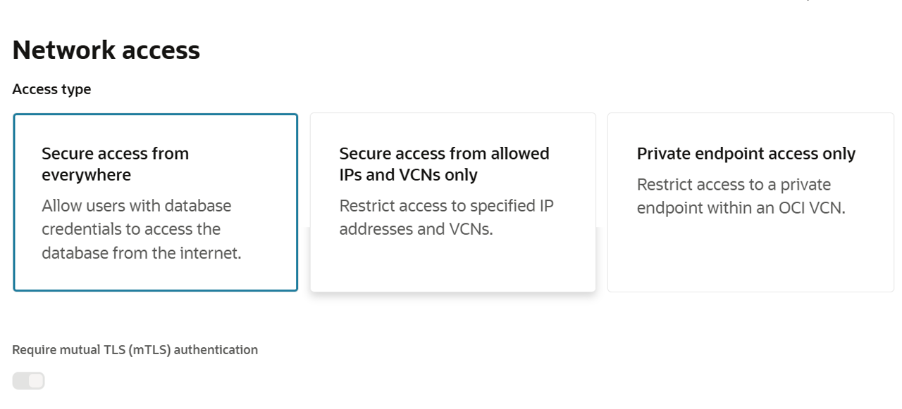

In the Contacts for operational notifications and announcements section, provide a contact email address. The Contact email field allows you to list contacts to receive operational notices and announcements as well as unplanned maintenance notifications.

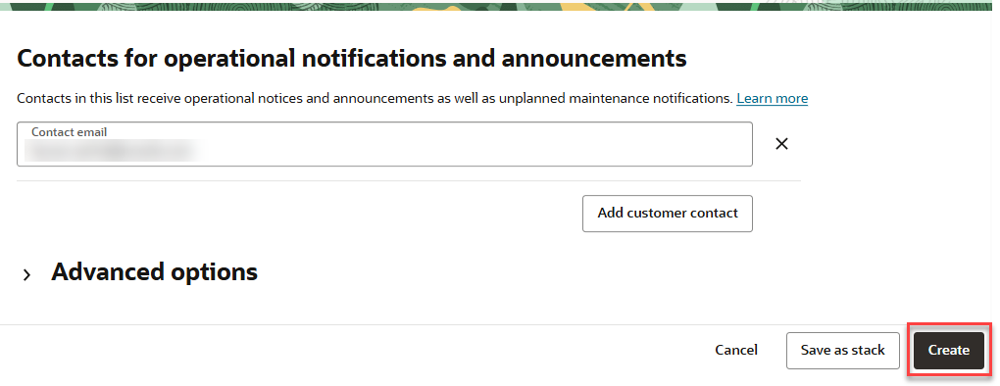

Click Create.

The Autonomous AI Database details page is displayed. The status of your ADB instance is Provisioning.

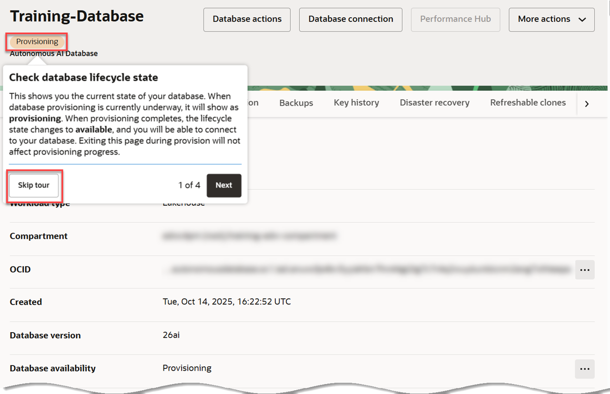

A Check database lifecycle state informational box is displayed. You can navigate through this tour or choose to skip it. Click Skip tour. A Skip guided tour dialog box is displayed. Click Skip.

In a few minutes, the instance status changes to Available. At this point, your Autonomous AI Database instance is ready to use! Review your instance's details including its name, database version, ECPU count, and storage size.

Note: In the following screen sample, the database display name is Training-Database and the database name is TrainingDatabase. In your example, your database display name and database name might be different.

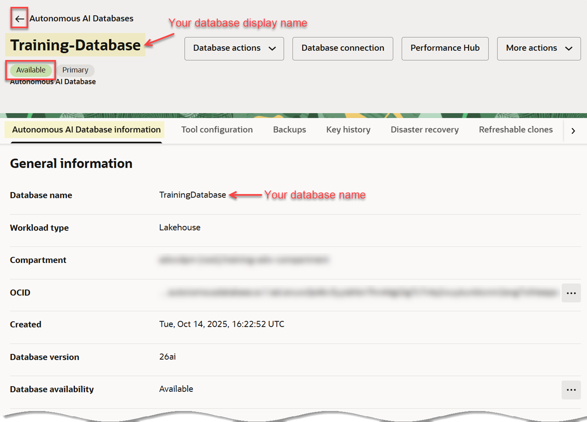

  Click the Autonomous AI Databases link in the top left of the page. The Autonomous AI Database page is displayed.

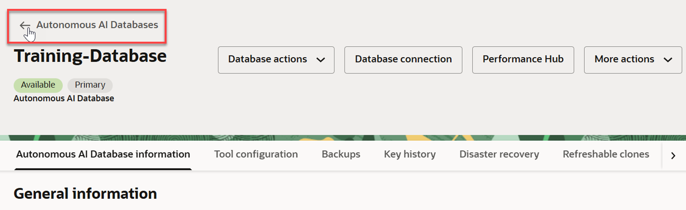

Your new Autonomous AI Database instance is displayed.

In the following sample screen capture, the instance display name is Training-Database.

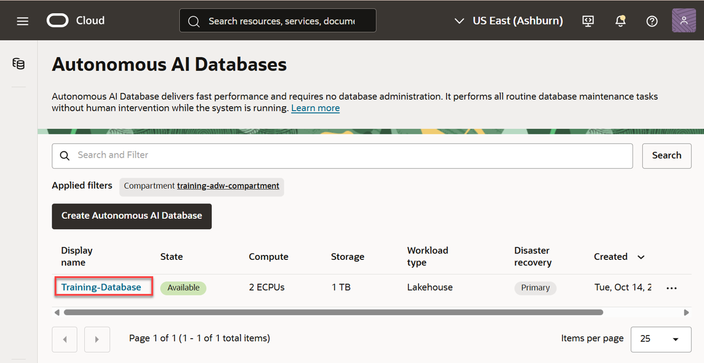

An email message is sent to the contact email that you provided. The email contains useful links that you can use to launch Database Actions, view the Get Started with Autonomous AI Database Web page, and access the online forums to post a question and collaborate with other Autonomous AI Database experts.

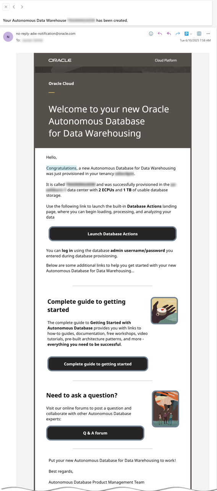

## Task 2: Create an Autonomous AI Database User

To create a user:

1. If you are not already signed in, sign into your OCI account, click the cloud menu on the left to open the left navigation pane, and click Oracle AI Database. On the right, click Autonomous AI Database.

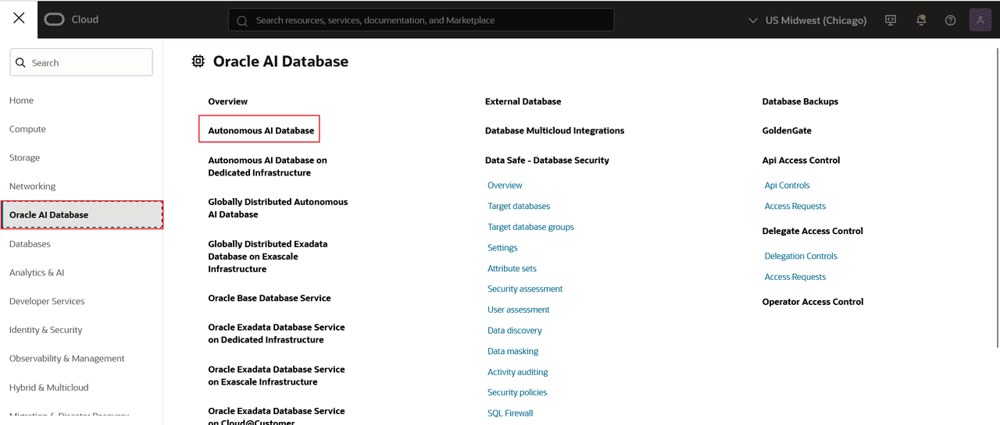

2. Click the Oracle Autonomous AI Database that you have provisioned for this workshop. Here, click the instance Training-Database.

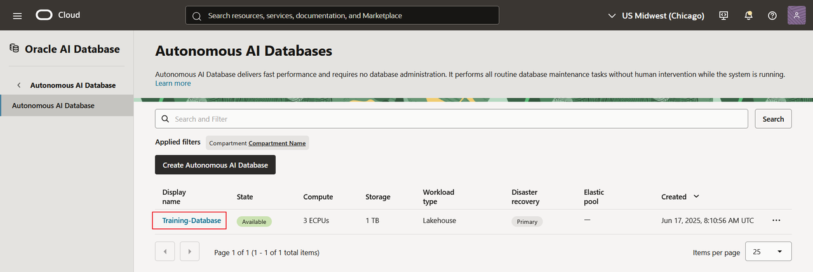

3. On the Autonomous AI Database details page, click Database Actions, and then select the Database Users option.

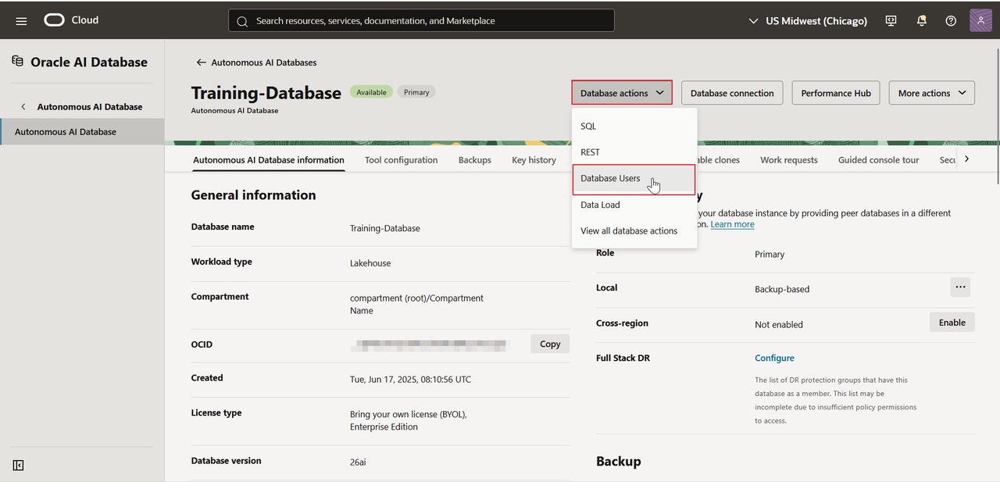

4. Before you get to the Oracle Database Actions Launchpad page, you might be asked to log in, depending on the browser you are using. If this is the case make sure to enter ADMIN and the password you gave the administrator user.

5. Click Create User. The Create User dialog opens.

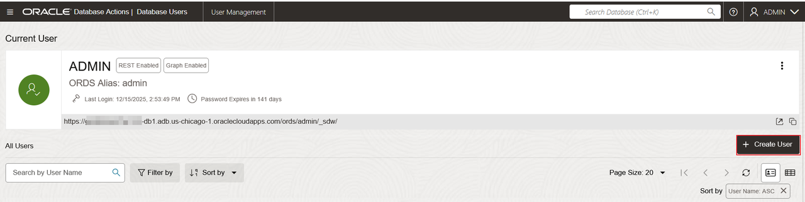

6. On the Create User dialog, enter the following details and click Create User:

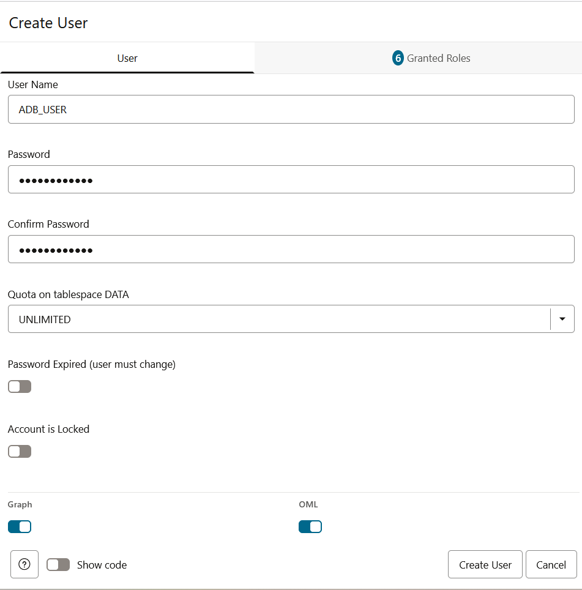

  - User Name: Enter the user name ADB_USER.

  - Password: Enter a password for this user. The password must be 12 to 30 characters and contain at least one uppercase letter, one lowercase letter, and one number. The password cannot contain the double quote (") character or the username itself.

  - Confirm Password: Re-enter the password that you entered in the Password field.

  - Quota of tablespace data: Click on the drop-down list and select an option. For this lab and a typical Always Free ADB, UNLIMITED is selected.

  - Password Expired: Select this option if you want the user to reset their own password.

  - Account is locked: Use this option to lock the account.

  - OML: Select this option to allow this user to access Oracle Machine Learning. This is a required field.

  - Graph: Optionally, select this option to enable graph for this user.

  - Web Access: Select this option to allow Web and DB Actions access to this user via its own url. This is an optional field.

  - Show Code: Click this option to view the code to create the user and grant roles to the user. You also have the option to copy the code.

7. After the user is created successfully, the message User ADB_USER created successfully is displayed.

## Task 3: Grant Privileges

Click on your database instance and navigate to the Tool Configuration tab.

Click Copy to copy the Database Actions URL.

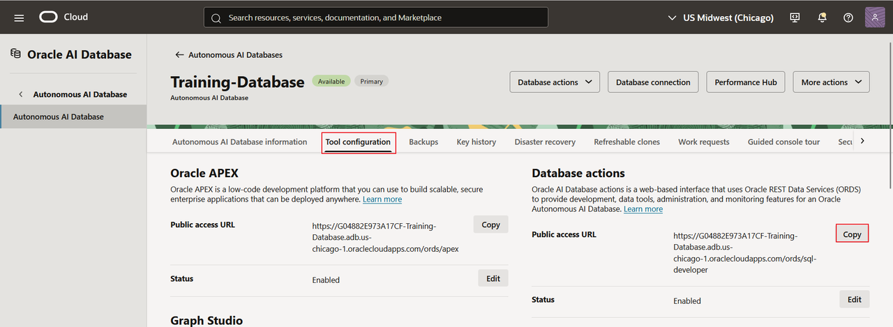

Paste the URL in your browser.

Login as an ADMIN user.

Click Development tab and click SQL on the left-hand navigation in the Database Actions|Launchpad screen. This opens the SQL worksheet.

Grant the following to the schema user:

1. GRANT EXECUTE on DBMS_CLOUD_AI to ADB_USER;

2. GRANT EXECUTE on DBMS_CLOUD_AI_AGENT to ADB_USER;

3. GRANT EXECUTE on DBMS_CLOUD_PIPELINE to ADB_USER;

4. GRANT EXECUTE on DBMS_VECTOR to ADB_USER;

5. GRANT CREATE ANY INDEX to ADB_USER;

6. GRANTEXECUTEON DBMS_CLOUD TO ADB_USER;

Replace ADB_USER with the schema user name.

## Task 4: Generate SSH Keys with PuTTYgen

In this task, you generate the SSH key pair that you will use to connect to the OCI Compute instance.

1. Open PuTTYgen on your local machine.

2. Select the radio button for EdDSA and confirm that Ed25519 is selected by default.

3. Click Generate.

4. Move your mouse in the blank area to provide entropy for the key generation process.

5. Save the private key as a .ppk file. You can set an optional passphrase.

6. Copy the public key text and save it for later use in the OCI Console.

The expected output should look like:

```text
<copy>
Public key for pasting into OpenSSH authorized_keys file:
ssh-ed25519 AAA...

</copy>
```

## Task 5: Create an OCI Compute Instance

In this task, you will create an OCI Compute instance on which you will install and configure Select AI for Python.

In the OCI Console, open the navigation menu, click Compute, and then click Instances.

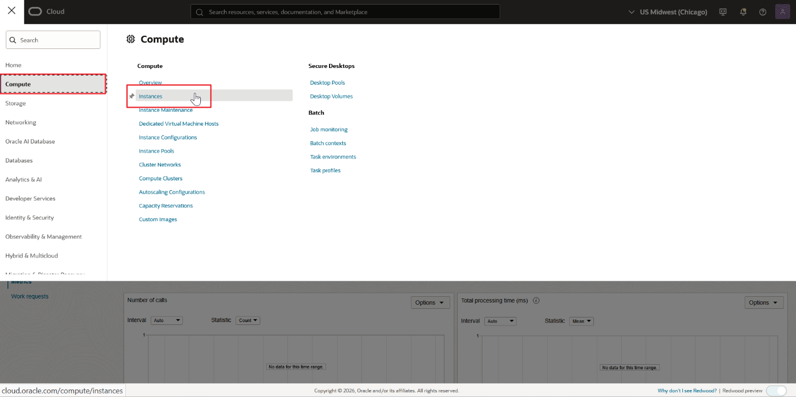

Click Create instance.

In Basic Information, enter a name for the instance and select your compartment.

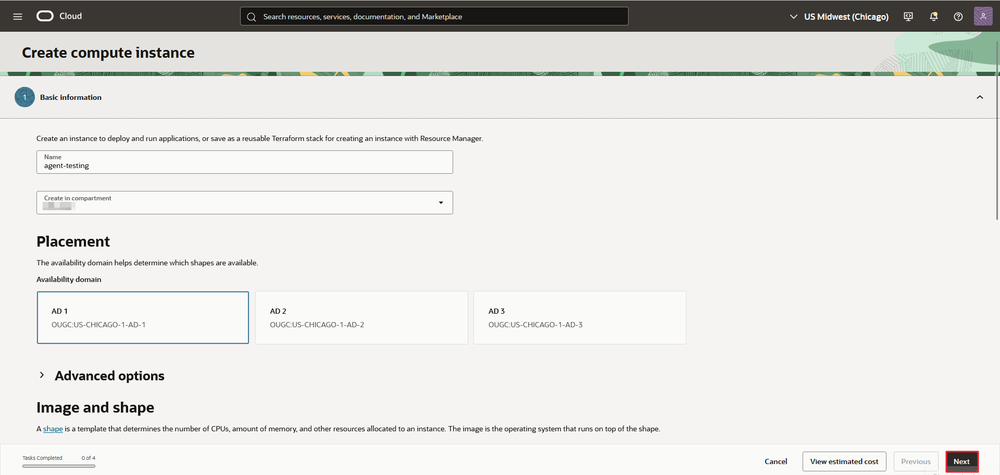

Accept the default values and click Next until you reach the Networking screen.

Under Primary VNIC, enter a value in the VNIC name field.

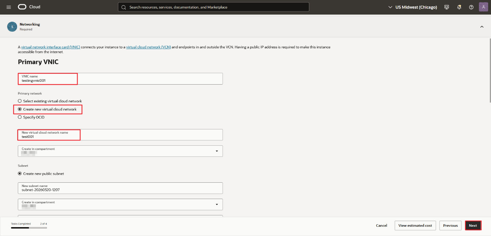

Select Create new virtual cloud network.

Enter a value in the New virtual cloud network name field and select your compartment.

Under Subnet, keep Create new public subnet selected.

Enter a value in the New subnet name field and confirm the compartment selection.

In the Add SSH keys section, select Paste public key and paste the public key you generated with PuTTYgen.

Continue through the remaining screens and accept the default values, review the details, and click Create.

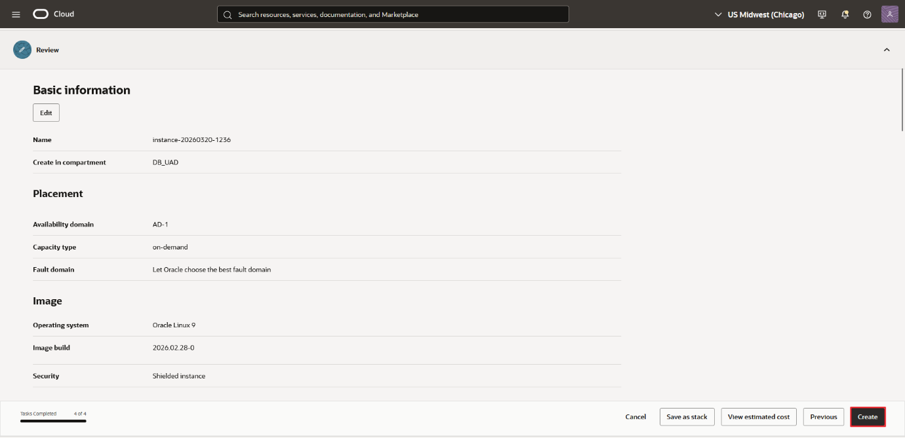

Now, the OCI Compute instance is in running state.

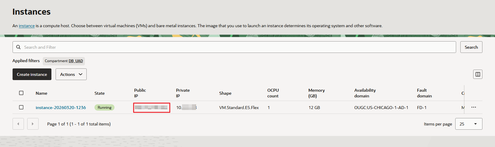

## Task 6: Install and configure Oracle Select AI for Python

In this task, you will connect to the OCI Compute instance using SSH with its public IP address and your private key and install Oracle Select AI for Python.

1. Open PuTTY, load the connection to the compute instance public IP address.

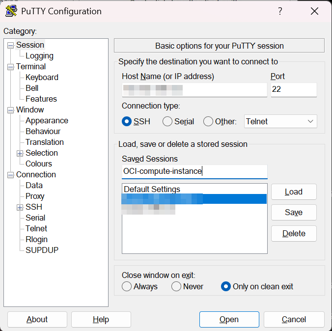

2. Optionally, set the keepalive time in seconds.

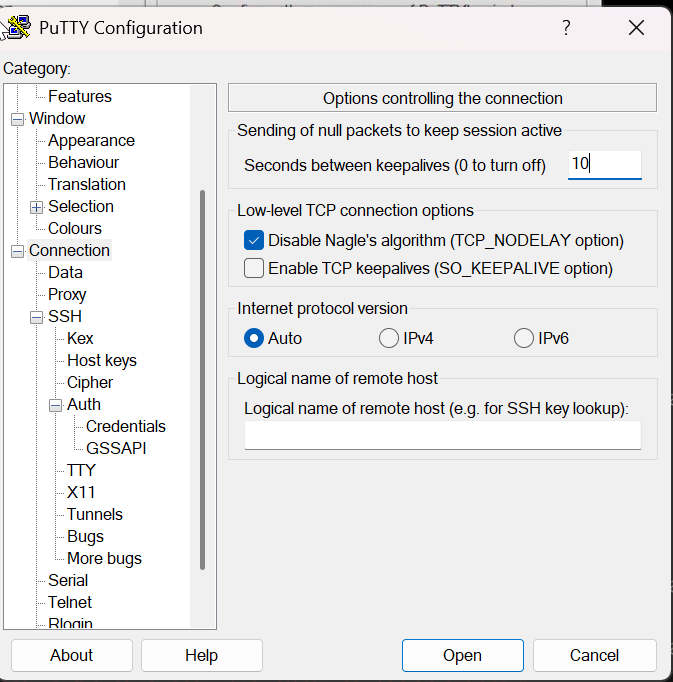

3. Navigate to Connection → SSH → Auth → Credentials and upload the private key that you generated using PuTTYgen.

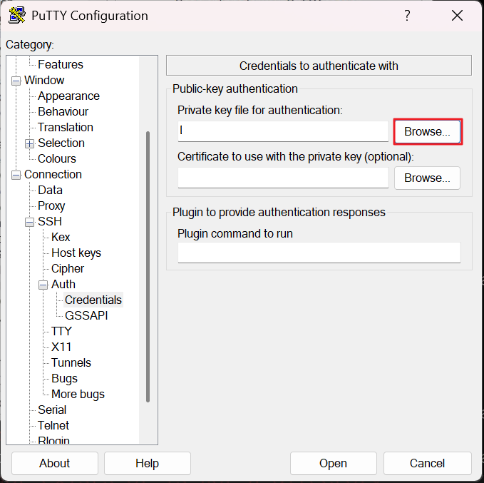

4. Save and connect to the compute instance public IP address and log in as the opc user.

5. Run the following command to enable the Oracle Linux 9 Developer repository, which provides the development packages required to install Oracle Select AI for Python.

```bash
<copy>
sudo dnf config-manager --enable ol9_developer
</copy>
```

6. Run the following command to install Python 3.12, the Python development libraries, and pip, which are required to install and use Oracle Select AI for Python.

```bash
<copy>
sudo dnf install -y python3.12 python3.12-devel python3.12-pip
</copy>
```

7. Run the following command to verify that Python 3.12 is installed successfully and to check its version

```bash
<copy>
python3.12 –version
</copy>
```

8. Run the following command to create a Python virtual environment named .venv for installing and managing Select AI for Python dependencies

```bash
<copy>
python3.12 -m venv .venv
</copy>
```

9. Run the following command to activate the Python virtual environment before installing and using Select AI for Python

```bash
<copy>
source .venv/bin/activate
</copy>
```

10. Run the following command to upgrade pip to the latest version before installing the required Python packages.

```bash
<copy>
python3.12 -m pip install --upgrade pip
</copy>
```

11. Run the following command to install or upgrade the latest version of the Select AI for Python package.

```bash
<copy>
python3.12 -m pip install --upgrade select_ai
</copy>
```

12. If you want the optional command line interface, install the cli

```bash
<copy>
python-mpipinstall--upgrade"select_ai[cli]"


13. Run the following command to install the OCI Python SDK, which is required to create the Select AI provider credential.

python3.12 -m pip install --upgrade oci

14. Run the following command to install the OCI CLI, which is required to configure the Select AI credential for the OCI Generative AI service

sudo dnf install python39-oci-cli

The expected output should look like:

Dependencies resolved.
Installing:
  python39-oci-cli ...
Is this ok [y/n]:

When you are prompted, enter y

Run the following command to verify the OCI CLI installation.

oci --version
</copy>
```

The expected output should look like:

3.x.x

Run the following command to start the OCI CLI configuration wizard.

```bash
<copy>
oci setup config
</copy>
```

Respond to the prompts as follows:

For Enter a location for your config [/home/opc/.oci/config]: press Enter

For Enter a user OCID: paste your User OCID

For Enter a tenancy OCID: paste your Tenancy OCID

For Enter the region ID: enter <your-gen-ai-region>

For Do you want to generate a new API Signing RSA key pair... [y/n] enter Y

For Enter a directory for your keys to be created [/home/opc/.oci]: press Enter

For Enter a name for your key [oci_api_key]: press Enter

For Enter a passphrase for your private Key ("N/A" for no passphrase): enter N/A

For confirmation, enter N/A again

Run the following command to display the public key that you will add to your OCI user profile.

```bash
<copy>
cat /home/opc/.oci/oci_api_key_public.pem
</copy>
```

The expected output should look like:

-----BEGIN PUBLIC KEY-----

...

-----END PUBLIC KEY-----

In the OCI Console, click your profile icon, click your name or email address, open the Tokens and Keys tab, go to API Keys, click Add API Key, select Paste a public key, paste the public key, and click Add.

13. Download the wallet using OCI CLI

Use the OCI CLI command oci dbautonomous-database generate-wallet to download your Autonomous Database wallet. You only need the database OCID, a password for the wallet and file name.

```bash
<copy>
oci db autonomous-database generate-wallet --autonomous-database-id <OCID of your ADB instance> --file <filename>.zip --password <password>
</copy>
```

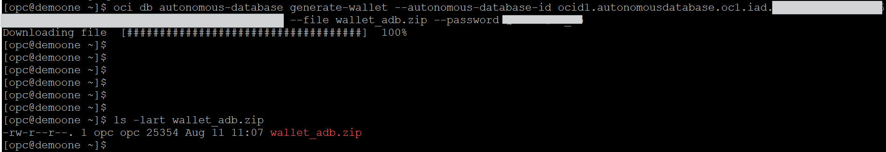

Create a wallet directory and move the wallet_adb.zip file into it.

```bash
<copy>
mkdir wallet
</copy>
```

```bash
<copy>
mv wallet_adb.zip wallet/
</copy>
```

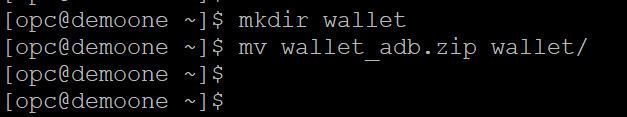

Navigate to the wallet directory and extract the wallet_adb.zip file.

```bash
<copy>
cd wallet
</copy>
```

```bash
<copy>
unzip wallet_adb.zip
</copy>
```

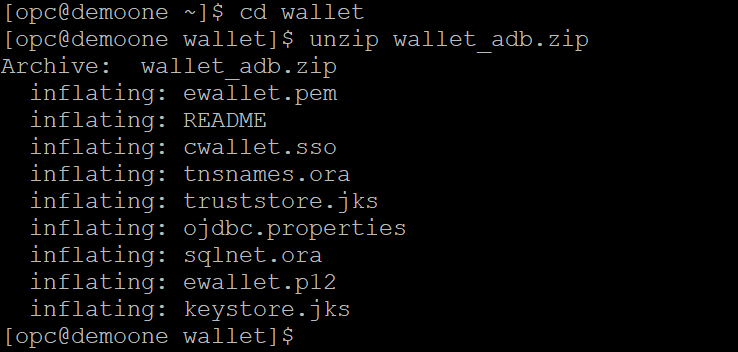

Update sqlnet.ora so that WALLET_LOCATION points to the extracted wallet directory: /home/opc/wallet.

pwd

```bash
<copy>
cat sqlnet.ora
</copy>
```

```bash
<copy>
vi sqlnet.ora
</copy>
```

```bash
<copy>
cat sqlnet.ora
</copy>
```

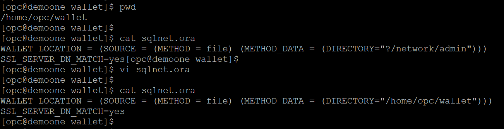

```python
<copy>


16. After the installation is complete, verify that the select_ai package can be imported successfully and used to connect to the Autonomous AI Database.

Set database connection environment variables:

exportSELECT_AI_USER =<select_ai_db_user>
      exportSELECT_AI_PASSWORD =<select_ai_db_password>
      exportSELECT_AI_DB_CONNECT_STRING =<db_connect_string>
export SELECT_AI_WALLET_DIR=<wallet-directory location>
      export SELECT_AI_WALLET_PASSWORD =<adb-wallet-password>

Where select_ai_db_user is database user, in my case it is ADB_USER
                            select_ai_db_password is database user password
                            db_connect_string is tns connection name like datasource_high, datasource_low for example

Create a file select_ai_connection_test.py

      import os
      import sys
      from pathlib import Path

import select_ai


def required_env(name):
value = os.getenv(name)
    if not value:
        print(f"Missing required environment variable: {name}")
        sys.exit(1)
    return value


user = required_env("SELECT_AI_USER")
password = required_env("SELECT_AI_PASSWORD")
dsn = required_env("SELECT_AI_DB_CONNECT_STRING")
wallet_dir = os.getenv("SELECT_AI_WALLET_DIR")
wallet_password = required_env("SELECT_AI_WALLET_PASSWORD")

wallet_path = Path(wallet_dir)

if not (wallet_path / "tnsnames.ora").exists():
    print(f"tnsnames.ora not found in {wallet_dir}")
    sys.exit(1)

if not (wallet_path / "ewallet.pem").exists():
    print(f"ewallet.pem not found in {wallet_dir}")
    sys.exit(1)

try:
    select_ai.connect(
        user=user,
        password=password,
        dsn=dsn,
        wallet_location=wallet_dir,
        config_dir=wallet_dir,
        wallet_password=wallet_password,
    )

    print("Connected to the Database")

except Exception as e:
    print("Connection failed:")
    print(e)
    sys.exit(1)

Run the python program select_ai_connection_test.py

python3.12 select_ai_connection_test.py

If the connection is successful, the script displays the message Connected to the Database.

</copy>
```

You may now proceed to the next lab.

```text
<copy>


</copy>
```

## Learn More

* [Provision an Autonomous AI Database Instance](https://docs.oracle.com/en/cloud/paas/autonomous-database/serverless/adbsb/autonomous-provision.html)
* [Create an OCI Compute Instance](https://docs.oracle.com/en-us/iaas/Content/Compute/Tasks/launchinginstance.htm)
* [Connect Python Applications to Autonomous AI Database](https://docs.oracle.com/en/cloud/paas/autonomous-database/serverless/adbsb/connecting-python.html)
* [Select AI Agent Framework Interfaces](https://docs.oracle.com/en/database/oracle/oracle-database/26/selai/select-ai-agent-interfaces.html)

## Acknowledgements

- **Created By:** Chandrakanth Putha, Oracle AI Database Product Manager
- **Contributors:** Mark Hornick, Product Management for Select AI and Machine Learning
- **Last Updated By:** Dhanish Kumar, Senior Member of Technical Staff
